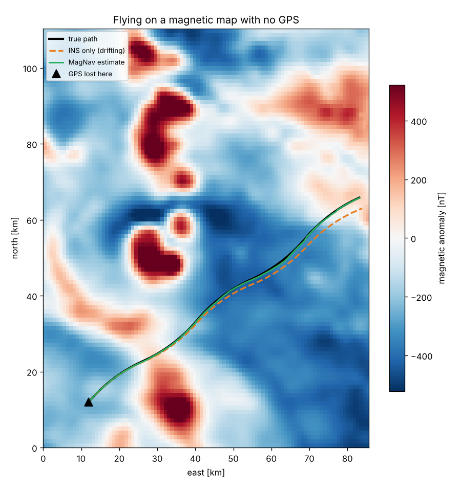
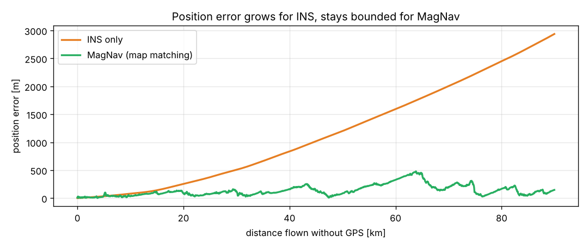

# Navigating Without GPS: Magnetic Anomaly Navigation in Python

A plane flies 90 km with GPS switched off and finds its way using only the Earth's magnetic field.

With GPS off, the plane's backup inertial navigation system (INS) drifts about **2.9 km** off course over the flight. Matching against a magnetic anomaly map keeps it within about **150 m**, roughly **20× better**.

## What this does

**Part 1: Clean the plane's magnetic noise (Tolles-Lawson).**
A magnetometer on a plane picks up the plane's own magnetism along with the Earth's field. Using 100 seconds of real calibration-flight data, the notebook builds the 18-term Tolles-Lawson model (permanent, induced and eddy-current effects), fits it with bandpass filtering and ridge regression, and subtracts the plane's field. The result matches the MagNav.jl reference to within 0.075 nT.

**Part 2: Navigate with a particle filter.**
Using a real magnetic anomaly map (about 86 × 110 km), the notebook simulates a 25-minute flight and a drifting INS. A 10,000-particle filter then compares each magnetometer reading against the map to estimate the plane's true position.

**Experiment: map quality.**
It also reruns the navigation with 1, 3, 10 and 25 nT of map error to show how much map accuracy matters.

## Run it

1. Open [Google Colab](https://colab.research.google.com) → **File → Upload notebook** → `MagNav_Build.ipynb`
2. **Runtime → Run all** (about 2–3 minutes, no installs needed)

The notebook downloads its data automatically from the MagNav.jl repository.

## Article and video

- Article: [Read it on Medium](https://medium.com/@sheetal.dubey29/i-turned-off-gps-and-flew-90-km-using-the-magnetism-in-the-rocks-below-4edc19fe7e90)
- Video: [Watch the YouTube Short](https://youtube.com/shorts/wMr8yzWPx8I)

## Sources and credit

- Data and reference implementation: [MagNav.jl](https://github.com/MIT-AI-Accelerator/MagNav.jl), MIT–Air Force AI Accelerator (public domain, U.S. Department of the Air Force)
- Workflow based on the [AFIT 2023 PLANS MagNav Tutorial](https://afit-eeng-magnav.github.io/2023-PLANS-MagNav-Tutorial/tutorial/2023-plans-magnav-tutorial.html)
- Tolles, W. E. & Lawson, J. D. (1950), *Magnetic compensation of MAD equipped aircraft*
- Q-CTRL (2025), *Quantum-assured magnetic navigation achieves positioning accuracy better than a strategic-grade INS in airborne and ground-based field trials*
